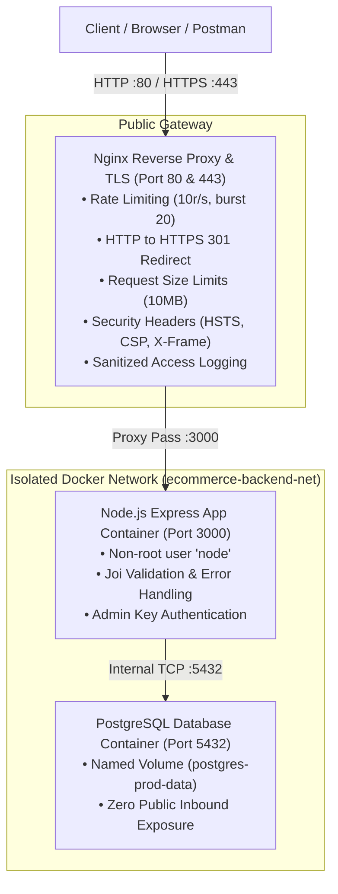

# Cloud Deployment & CI/CD – E-Commerce Platform

A production-grade, modular Node.js/Express and PostgreSQL REST API built as part of the backend engineering & DevOps assessment for **ALGIONS AI LABS PRIVATE LIMITED**.

---

## 📌 Project Overview

This repository provides the core backend API, database schema, containerization, and automation infrastructure for an E-Commerce Product and Order platform. The primary focus of this project is on production-grade engineering principles: modularity, resilient database pooling, request validation, structured error handling, containerization, observability, and automated CI/CD workflows.

---

## 🛠 Technology Stack

- **Runtime & Framework:** Node.js (v18+) & Express.js
- **Database:** PostgreSQL (v14+) with Connection Pooling (`pg`)
- **Validation:** Joi schema validation
- **Security:** Helmet, CORS, parameterized queries
- **Testing:** Jest & Supertest
- **Containerization:** Docker & Docker Compose (Multi-stage build)
- **CI/CD:** GitHub Actions

---

## 📂 Project Structure

```
ecommerce-cloud-devops/
├── .github/
│   └── workflows/
│       └── ci.yml                 # Automated CI workflow (Lint, Test, Docker Build)
├── database/
│   ├── schema.sql                 # DDL: products, orders, order_items, audit_logs
│   └── seed.sql                   # Sample product catalog & audit seed records
├── nginx/
│   └── nginx.conf                 # Production reverse proxy & rate limiting config
├── scripts/
│   ├── init-db.js                 # Schema migration runner
│   └── seed-db.js                 # Seed data population script
├── src/
│   ├── config/
│   │   ├── env.js                 # Centralized environment validator
│   │   └── database.js            # PostgreSQL connection pool & health probe
│   ├── controllers/
│   │   └── health.controller.js   # Liveness & readiness probe handlers
│   ├── middleware/
│   │   ├── errorHandler.js        # Centralized operational error handler
│   │   ├── notFoundHandler.js     # 404 handler for unmapped routes
│   │   └── validate.js            # Joi request validation middleware
│   ├── routes/
│   │   ├── health.routes.js       # Health endpoint definitions
│   │   └── index.js               # Master API router (/api/v1)
│   ├── services/
│   │   └── health.service.js      # System & database readiness service
│   ├── utils/
│   │   ├── apiError.js            # Custom operational ApiError class
│   │   ├── logger.js              # Structured logger
│   │   └── response.js            # Standardized API response formatters
│   ├── app.js                     # Express app setup (decoupled for testing)
│   └── server.js                  # Entrypoint with graceful shutdown & signal handlers
├── tests/
│   ├── integration/
│   │   └── health.test.js         # Integration tests for health probes & 404
│   └── unit/
│       ├── apiError.test.js       # Unit tests for ApiError
│       └── validate.test.js       # Unit tests for validation middleware
├── .dockerignore                  # Docker build exclusions
├── .env.example                   # Environment configuration template
├── .gitignore                     # Git exclusions (credentials, secrets, node_modules)
├── Dockerfile                     # Multi-stage production container definition
├── docker-compose.yml             # Orchestration for App and PostgreSQL
├── package.json                   # Project metadata and dependencies
└── README.md                      # Documentation
```

---

## 🗄 Database Design

The schema enforces strict relational integrity, check constraints, indexes, and automated timestamp triggers:

1. **`products`**: UUID primary key, SKU (unique index), title, description, price (CHECK `>= 0`), currency, inventory count (CHECK `>= 0`), category, status (`ACTIVE`, `INACTIVE`, `ARCHIVED`), and `updated_at` trigger.
2. **`orders`**: UUID primary key, unique human-readable order number, customer name and email, total amount, order lifecycle status (`PENDING`, `PAID`, `PROCESSING`, `SHIPPED`, `DELIVERED`, `CANCELLED`, `REFUNDED`), and shipping address.
3. **`order_items`**: Line items linked via foreign keys to `orders` (CASCADE) and `products` (RESTRICT), preserving historical unit price and quantity.
4. **`audit_logs`**: Immutable audit log capturing entity type, action, actor, IP address, and JSONB event payload for compliance and observability.

---

## 🚀 Getting Started

### Prerequisites

- [Node.js](https://nodejs.org/) (>= 18.0.0)
- [Docker & Docker Compose](https://www.docker.com/)
- [PostgreSQL](https://www.postgresql.org/) (optional if running via Docker)

### 1. Environment Setup

Copy `.env.example` to create `.env`:

```bash
cp .env.example .env
```

Adjust variables if running against a custom PostgreSQL instance:
```env
PORT=5000
NODE_ENV=development
DB_HOST=localhost
DB_PORT=5432
DB_NAME=ecommerce_dev
DB_USER=postgres
DB_PASSWORD=postgres
```

### 2. Install Dependencies

```bash
npm install
```

### 3. Start PostgreSQL and Initialize Database

#### Option A: Using Docker Compose (Recommended)
Spins up PostgreSQL container and automatically maps port `5432`:
```bash
docker compose up -d postgres
```

#### Option B: Run Migration & Seed Scripts
Run the database creation and seeding scripts against the running database:
```bash
npm run db:init
npm run db:seed
```

### 4. Start the Application

#### Development Mode (with hot-reload):
```bash
npm run dev
```

#### Production Mode:
```bash
npm start
```

#### Full Stack via Docker Compose:
Spins up both the PostgreSQL database and Express API container:
```bash
docker compose up --build
```

---

## 🔍 Health & Verification Endpoints

| Method | Endpoint | Description | Expected Status |
|---|---|---|---|
| `GET` | `/` | Root API service information & endpoints index | `200 OK` |
| `GET` | `/health` | Basic liveness probe (uptime, node version, environment) | `200 OK` |
| `GET` | `/health/ready` | Deep readiness probe (checks PostgreSQL connectivity & latency) | `200 OK` / `503 Degraded` |
| `GET` | `/api/v1/health` | Versioned API health route | `200 OK` |

### Sample Readiness Response (`GET /health/ready`):
```json
{
  "success": true,
  "message": "All dependencies are healthy",
  "data": {
    "status": "UP",
    "uptimeSeconds": 14,
    "timestamp": "2026-11-14T08:47:29.786Z",
    "environment": "development",
    "version": "1.0.0",
    "system": {
      "nodeVersion": "v22.14.0",
      "platform": "win32",
      "arch": "x64",
      "memoryUsageMB": { "rss": 42, "heapUsed": 18, "heapTotal": 24 }
    },
    "dependencies": {
      "database": {
        "type": "PostgreSQL",
        "status": "CONNECTED",
        "latencyMs": 8,
        "pool": {
          "totalCount": 1,
          "idleCount": 1,
          "waitingCount": 0
        }
      }
    }
  },
  "timestamp": "2026-11-14T08:47:29.786Z"
}
```

---

## 🧪 Running Automated Tests

Run the test suite powered by Jest and Supertest:

```bash
# Run all unit and integration tests
npm test

# Run tests with coverage report
npm run test:coverage
```

---

## 🔒 Security & Git Policies

- `.env`, `.pem`, `.key`, and credential files are strictly excluded via `.gitignore`.
- HTTP Security headers configured via `helmet`.
- SQL injection prevention via PostgreSQL parameterized queries (`$1, $2, ...`).
- Input validation enforced at the middleware layer via Joi.
- Non-root user execution inside Docker container (`USER node`).


---

## ☁️ AWS EC2 Production Deployment Guide

This guide details the step-by-step procedure for deploying the E-Commerce Platform on an Ubuntu-based AWS EC2 instance following production-grade security, isolation, and observability standards.

### 1. EC2 Instance & Architecture Specifications

| Parameter | Recommended Production Value | Justification |
| :--- | :--- | :--- |
| **Instance Type** | `t2.micro` (or `t3.micro` where available) | **AWS Free Tier eligible** (1 vCPU, 1 GB RAM, sufficient for Node.js Alpine + PostgreSQL) |
| **Operating System** | **Ubuntu 24.04 LTS** (Noble Numbat) or **22.04 LTS** | Long Term Support, stable kernel, verified Docker Engine support |
| **Storage (EBS)** | 30 GB gp3 / gp2 root volume | Free-tier eligible (up to 30 GB EBS), ample space for Docker images and DB volume |
| **Network & VPC** | Default VPC or Custom Public Subnet | Auto-assign public IPv4 enabled |

### 2. Security Group Configuration (Least Privilege)

Create a dedicated Security Group (e.g., `ecommerce-api-sg`) with minimal required inbound rules:

| Type | Protocol | Port Range | Source | Purpose |
| :--- | :--- | :--- | :--- | :--- |
| **SSH** | TCP | `22` | `YOUR_PUBLIC_IP/32` | **Restricted SSH access** (Admins only, never 0.0.0.0/0) |
| **HTTP** | TCP | `80` | `0.0.0.0/0` | Public API & Nginx Reverse Proxy traffic |
| **HTTPS** | TCP | `443` | `0.0.0.0/0` | Secure SSL/TLS web traffic |

> [!CAUTION]
> **PostgreSQL (Port 5432)** and internal **Node.js (Port 3000)** must **NEVER** be open in the AWS Security Group. They communicate strictly over the internal isolated Docker bridge network (`ecommerce-backend-net`).

### 3. Step-by-Step Server Setup & Deployment

#### Step 1: Connect to the EC2 Instance via SSH
```bash
chmod 400 your-key.pem
ssh -i your-key.pem ubuntu@<EC2_PUBLIC_IPV4_ADDRESS>
```

#### Step 2: Clone the Project Repository
```bash
# Clone the repository
git clone https://github.com/AbhishekDixitt18/E-Commerce_Platform.git
cd E-Commerce_Platform
```

#### Step 3: Run the Automated Deployment Script
```bash
# Grant execution permissions
chmod +x scripts/deploy-ec2.sh scripts/verify-deployment.sh

# Run automated deployment
./scripts/deploy-ec2.sh
```
The automated script will:
1. Install Docker Engine and the Docker Compose plugin from official Docker APT repositories.
2. Add the `ubuntu` user to the `docker` group.
3. Generate a secure, production `.env` file with cryptographically random database passwords and admin API keys.
4. Launch the multi-container stack (`nginx`, `app`, `postgres`) via `docker-compose.prod.yml`.
5. Wait for container health checks to pass.
6. Automatically run the verification suite.

#### Manual Alternative (Step-by-Step):
```bash
# 1. Update and install Docker
sudo apt-get update -y
sudo apt-get install -y ca-certificates curl gnupg lsb-release
sudo install -m 0755 -d /etc/apt/keyrings
curl -fsSL https://download.docker.com/linux/ubuntu/gpg | sudo gpg --dearmor -o /etc/apt/keyrings/docker.gpg --yes
sudo chmod a+r /etc/apt/keyrings/docker.gpg
echo "deb [arch=$(dpkg --print-architecture) signed-by=/etc/apt/keyrings/docker.gpg] https://download.docker.com/linux/ubuntu $(lsb_release -cs) stable" | sudo tee /etc/apt/sources.list.d/docker.list > /dev/null
sudo apt-get update -y
sudo apt-get install -y docker-ce docker-ce-cli containerd.io docker-compose-plugin
sudo usermod -aG docker $USER

# 2. Configure Environment Variables
cp .env.example .env
nano .env  # Populate DB_PASSWORD and ADMIN_API_KEY with strong secrets

# 3. Deploy via Docker Compose
docker compose -f docker-compose.prod.yml up -d --build

# 4. Inspect container health
docker compose -f docker-compose.prod.yml ps
```

### 4. Post-Deployment Verification & Evidence

Run the automated verification script to validate all endpoints, transactions, and security barriers:

```bash
./scripts/verify-deployment.sh "http://<EC2_PUBLIC_IP>"
```

Expected verification output:
- `[PASS] Docker Container Orchestration | Expected: api & postgres running | Actual: Containers active`
- `[PASS] Liveness Probe (GET /health) | Expected: HTTP 200 | Actual: HTTP 200`
- `[PASS] Readiness Probe (GET /ready) | Expected: HTTP 200 (DB connected) | Actual: HTTP 200`
- `[PASS] Product Catalog (GET /api/v1/products) | Expected: HTTP 200 | Actual: HTTP 200`
- `[PASS] Product Detail (GET /api/v1/products/:id) | Expected: HTTP 200 | Actual: HTTP 200`
- `[PASS] Create Order (POST /api/v1/orders) | Expected: HTTP 201 | Actual: HTTP 201`
- `[PASS] Order Idempotency Guard | Expected: HTTP 200 (Existing Order) | Actual: HTTP 200`
- `[PASS] Admin Route Protection (No Key) | Expected: HTTP 401 Unauthorized | Actual: HTTP 401`
- `[PASS] Admin Product Creation & Audit (With Key) | Expected: HTTP 201 Created | Actual: HTTP 201`


---

## 🛡️ Nginx Reverse Proxy & HTTPS Architecture

The production deployment utilizes **Nginx (v1.25 Alpine)** as a hardened, high-performance reverse proxy and TLS termination gateway fronting the Node.js Express backend and PostgreSQL database.



### 1. Reverse Proxy & Security Features

- **Port Isolation**: The Node.js application container (`app:3000`) and PostgreSQL (`postgres:5432`) are completely bound to the private internal Docker bridge network (`ecommerce-backend-net`). Neither port is published to the public host interface.
- **Proxy Headers**: Nginx sets essential forwarding headers for downstream traceability and WebSocket compatibility:
  - `Host $host`
  - `X-Real-IP $remote_addr`
  - `X-Forwarded-For $proxy_add_x_forwarded_for`
  - `X-Forwarded-Proto $scheme`
  - `X-Forwarded-Host $host`
  - `X-Forwarded-Port $server_port`
- **Request Size & Timeouts**:
  - `client_max_body_size 10M;` — Blocks oversized body uploads to prevent buffer exhaustion.
  - `client_body_timeout 15s;` & `client_header_timeout 15s;` — Protects against Slowloris attacks.
  - `proxy_connect_timeout 60s;` & `proxy_read_timeout 60s;` — Accommodates database query latency.
- **Server Token Obfuscation**: `server_tokens off;` strips Nginx version identifiers from HTTP response headers and error pages.
- **Sanitized Logging**: Access log format (`sanitized_combined`) explicitly omits sensitive HTTP headers such as `Authorization`, `x-api-key`, and request payloads to ensure zero credential leakage in server logs.
- **Security Headers Injected**:
  - `Strict-Transport-Security "max-age=31536000; includeSubDomains" always;`
  - `X-Frame-Options "DENY" always;`
  - `X-Content-Type-Options "nosniff" always;`
  - `X-XSS-Protection "1; mode=block" always;`
  - `Referrer-Policy "strict-origin-when-cross-origin" always;`
  - `Content-Security-Policy "default-src 'self'; script-src 'self'; style-src 'self' 'unsafe-inline'; ..."`

---

### 2. HTTPS Setup with Custom Domain (Let's Encrypt / Certbot)

When a domain name (e.g., `api.yourdomain.com`) is pointed to the EC2 Public IP:

#### Step 1: Install Certbot on the EC2 Host
```bash
sudo apt-get update -y
sudo apt-get install -y certbot python3-certbot-nginx
```

#### Step 2: Request the Let's Encrypt Certificate via ACME Webroot
```bash
sudo certbot certonly --webroot -w /var/www/certbot \
  -d api.yourdomain.com \
  --email admin@yourdomain.com \
  --agree-tos --no-eff-email
```

#### Step 3: Mount the Live Certificates in Docker Compose
Update `docker-compose.prod.yml` to mount the Let's Encrypt directory:
```yaml
volumes:
  - ./nginx/nginx.conf:/etc/nginx/nginx.conf:ro
  - /etc/letsencrypt/live/api.yourdomain.com/fullchain.pem:/etc/nginx/ssl/server.crt:ro
  - /etc/letsencrypt/live/api.yourdomain.com/privkey.pem:/etc/nginx/ssl/server.key:ro
```
Reload Nginx:
```bash
docker compose -f docker-compose.prod.yml restart nginx
```

#### Step 4: Automated Certificate Renewal
Certbot installs a systemd timer by default. You can test and verify renewal via:
```bash
# Test dry run
sudo certbot renew --dry-run

# Automate Nginx reload hook upon successful renewal
echo "0 3 * * * root certbot renew --quiet --post-hook 'docker compose -f /home/ubuntu/E-Commerce_Platform/docker-compose.prod.yml restart nginx'" | sudo tee -a /etc/crontab
```

---

### 3. HTTPS Setup without Domain (Self-Signed SSL)

If no custom domain is available, use the automated self-signed SSL generator:

```bash
# Generate self-signed certificate for your EC2 Public IP or localhost
./scripts/generate-self-signed-ssl.sh "<EC2_PUBLIC_IP>"
```

The script generates:
- `nginx/ssl/server.crt` (X.509 Certificate, 2048-bit RSA, valid for 365 days, includes IP and localhost SANs)
- `nginx/ssl/server.key` (Private key with strict 0600 file permissions)

#### ⚠️ Limitations of Self-Signed Certificates
1. **Browser Security Warnings**: Modern browsers will display `NET::ERR_CERT_AUTHORITY_INVALID` ("Your connection is not private") because the certificate is signed by an untrusted local authority rather than an accredited public Certificate Authority (CA) like Let's Encrypt or DigiCert.
2. **Client Verification Requirement**: API clients and testing utilities (e.g. `curl`, Postman) require passing `-k` / `--insecure` to bypass certificate authority validation.
3. **No Revocation Checking**: Self-signed certificates cannot be verified via OCSP (Online Certificate Status Protocol) or CRLs.
4. **Scope of Use**: Strictly intended for development, staging, internal VPC testing, and proving TLS termination in sandbox assessment environments.

---

### 4. HTTP & HTTPS Testing & Verification

Run the unified verification suite against both protocols:

```bash
# Verify over HTTP (Tests port 80 health and HTTP-to-HTTPS redirect)
sudo ./scripts/verify-deployment.sh "http://<EC2_PUBLIC_IP>"

# Verify over HTTPS (Tests port 443 TLS handshake, security headers & APIs)
sudo ./scripts/verify-deployment.sh "https://<EC2_PUBLIC_IP>"
```

---

## 📊 Site Reliability Engineering (SRE): Observability & Metrics

The E-Commerce platform includes an end-to-end observability stack with structured JSON logging, deep health monitoring, Prometheus metric instrumentation, and automated failure testing.

### 1. Structured JSON Logging
- **Standard Format:** Every incoming request and system event generates a structured JSON log entry containing:
  - `timestamp`: ISO 8601 UTC timestamp
  - `level`: Log level (`INFO`, `WARN`, `ERROR`, `DEBUG`)
  - `method`: HTTP request method (`GET`, `POST`, etc.)
  - `route`: Normalized request route (`/api/v1/products/:id`)
  - `statusCode`: HTTP response status code
  - `durationMs`: Request latency in milliseconds
  - `ip`: Client remote IP address
  - `userAgent`: Client user agent string
- **Sensitive Data Redaction:** Passwords, API keys, JWT tokens, credit card numbers, and authorization headers are recursively sanitized (`[REDACTED]`) before logging.

### 2. Health & Readiness Probes
- **Liveness Probe (`GET /health`):** Fast application process status, uptime, node version, and system memory. Used by Docker `HEALTHCHECK` and AWS ALB.
- **Readiness Probe (`GET /ready` or `GET /health/ready`):** Deep dependency check verifying PostgreSQL connectivity and connection pool status (total, idle, waiting). Returns HTTP 200 `UP` or HTTP 503 `DEGRADED`.
- **Docker Health Checks:** Configured in `docker-compose.yml` and `docker-compose.prod.yml` with automated retry, backoff, and dependency ordering (`condition: service_healthy`).

### 3. Prometheus Metrics (`/metrics`)
The application exposes Prometheus-compatible metrics at `/metrics`:
- `http_requests_total`: Counter tracking total processed requests with labels `method`, `route`, and `status_code`.
- `http_request_duration_seconds`: Histogram tracking request latencies with buckets from 5ms to 10s.
- `app_uptime_seconds`: Gauge reporting continuous process uptime.
- `db_pool_total_connections`, `db_pool_idle_connections`, `db_pool_waiting_clients`: Real-time PostgreSQL pool health gauges.
- `nodejs_*`: Complete Node.js runtime metrics (CPU, memory, event loop lag, GC pauses).

### 4. Prometheus Scraper Configuration (`prometheus/prometheus.yml`)
Prometheus scrapes the API container every 5 seconds on internal port `3000`:
- **Prometheus UI:** Accessible on port `9090` (e.g., `http://<EC2_PUBLIC_IP>:9090`).
- **Scrape Targets:** `app:3000` (service: `ecommerce-api`).

---

## 🛠 SRE Troubleshooting Guide

Common operations for diagnosing, managing, and maintaining the production deployment:

### 1. Check Application Logs (Real-time Structured Logs)
```bash
# Production Docker Compose logs
docker compose -f docker-compose.prod.yml logs -f app

# Filter only ERROR logs
docker compose -f docker-compose.prod.yml logs app | grep '"level":"ERROR"'
```

### 2. Check Database Logs
```bash
# View PostgreSQL container logs
docker compose -f docker-compose.prod.yml logs -f postgres

# Inspect recent database connections and queries
docker compose -f docker-compose.prod.yml logs --tail=100 postgres
```

### 3. Check Container Status & Health
```bash
# List all running containers with health status
docker compose -f docker-compose.prod.yml ps

# Inspect detailed health status of the application container
docker inspect --format='{{json .State.Health}}' ecommerce-api-prod | jq .
```

### 4. Check Application Health & Metrics
```bash
# Fast Liveness Probe
curl -i http://127.0.0.1/health

# Deep Database Readiness Probe
curl -i http://127.0.0.1/ready

# Prometheus Metrics Scrape
curl -s http://127.0.0.1/metrics | head -n 30
```

### 5. Restart Failed Services
```bash
# Restart the API backend service
docker compose -f docker-compose.prod.yml restart app

# Restart the entire stack cleanly
docker compose -f docker-compose.prod.yml restart

# Rebuild and recreate a failed container
docker compose -f docker-compose.prod.yml up -d --force-recreate app
```

---

## 🧪 Controlled Application Failure & Recovery Test

Demonstrates a controlled outage and automated recovery verification:

```bash
# Run the automated SRE Failure and Recovery Suite
sudo ./scripts/failure-test.sh "http://127.0.0.1"
```

The script executes 5 phases:
1. **Phase 1 (Baseline):** Verifies `/health`, `/ready`, and `/metrics` return HTTP 200.
2. **Phase 2 (Controlled Outage):** Gracefully stops the `ecommerce-api-prod` container.
3. **Phase 3 (Outage Verification):** Verifies incoming requests fail with HTTP 502 Bad Gateway through Nginx.
4. **Phase 4 (Recovery):** Restarts the container and polls container health status until healthy.
5. **Phase 5 (Post-Recovery Verification):** Confirms end-to-end recovery of health probes, database connection pool, and Prometheus metrics.

---

## 💾 Database Reliability Engineering: Backup, Restore & Rollback

Comprehensive procedures for database backup creation, isolated verification restores, disaster recovery, and application container rollbacks.

### 1. Database Backup (`scripts/backup.sh`)
Generates timestamped, compressed (`.sql.gz`) PostgreSQL backups using `pg_dump`:
- **Security:** Masks database credentials (`PGPASSWORD`), isolates environment variables, and locks file permissions to `0600` (owner read/write only).
- **Format:** Clean SQL dump with `--clean --if-exists --no-owner --no-privileges` piped directly through high-compression `gzip -9`.
- **Integrity Validation:** Validates file size and verifies gzip decompressibility before marking the backup as successful.

```bash
# Execute automated database backup
sudo ./scripts/backup.sh
```

Backups are saved to `backups/` (e.g. `backups/ecommerce_prod_backup_YYYYMMDD_HHMMSS.sql.gz`).

### 2. Database Restore (`scripts/restore.sh`)
Restores backups into isolated test environments or production with strict safety controls:

#### Safe Isolated Test Restore (Default)
Restores the backup into a sandboxed test database (`ecommerce_restore_test`) to verify table integrity without risking production:
```bash
sudo ./scripts/restore.sh backups/<BACKUP_FILE>.sql.gz
```

#### Production Database Restore (Requires Explicit Confirmation)
To prevent catastrophic accidental overwrites, restoring over production enforces a safety gate requiring explicit confirmation:
```bash
# Interactive prompt (requires typing 'OVERWRITE_PRODUCTION'):
sudo ./scripts/restore.sh backups/<BACKUP_FILE>.sql.gz ecommerce_prod

# Non-interactive / CI/CD automation flag:
sudo ./scripts/restore.sh backups/<BACKUP_FILE>.sql.gz ecommerce_prod --confirm-production
```

### 3. End-to-End Backup & Restore Verification Suite
Automated verification pipeline that tests the full lifecycle:
1. Queries source database metrics (baseline product, order, and item counts).
2. Generates a fresh timestamped backup via `backup.sh`.
3. Verifies archive integrity, permissions, and SHA256 checksums.
4. Restores into a dynamically created isolated test database (`ecommerce_verify_restore_<timestamp>`).
5. Performs entity row count parity comparison between source and restored database.
6. Automatically drops the isolated verification database upon completion.

```bash
# Execute end-to-end verification
sudo ./scripts/verify-backup-restore.sh
```

---

## 🔄 Application Container Rollback Guide

Procedure for rolling back the application to a previous stable Docker image when an incident occurs:

### Step 1: Identify Available Stable Image Tags
Inspect local Docker images or Docker Hub tags:
```bash
# List local images and creation dates
docker images --filter "reference=abhishekdixitt18/ecommerce-cloud-devops" \
  --format "table {{.Repository}}\t{{.Tag}}\t{{.ID}}\t{{.CreatedSince}}"
```

### Step 2: Roll Back Using the Automated Rollback Utility
Run the automated rollback script specifying the previous stable tag or commit SHA:
```bash
# Roll back to specific image tag (e.g., commit SHA or release tag)
sudo ./scripts/rollback.sh b275b7e

# Or rollback to latest stable
sudo ./scripts/rollback.sh latest
```

### Step 3: Manual Rollback Procedure
If executing rollback manually:
```bash
# 1. Update APP_IMAGE in .env or shell environment
export APP_IMAGE="abhishekdixitt18/ecommerce-cloud-devops:b275b7e"

# 2. Recreate application container with previous image
docker compose -f docker-compose.prod.yml up -d --no-deps --force-recreate app

# 3. Verify container health status
docker inspect --format='{{json .State.Health.Status}}' ecommerce-api-prod

# 4. Probe health and readiness endpoints
curl -i http://127.0.0.1/health
curl -i http://127.0.0.1/ready
```
