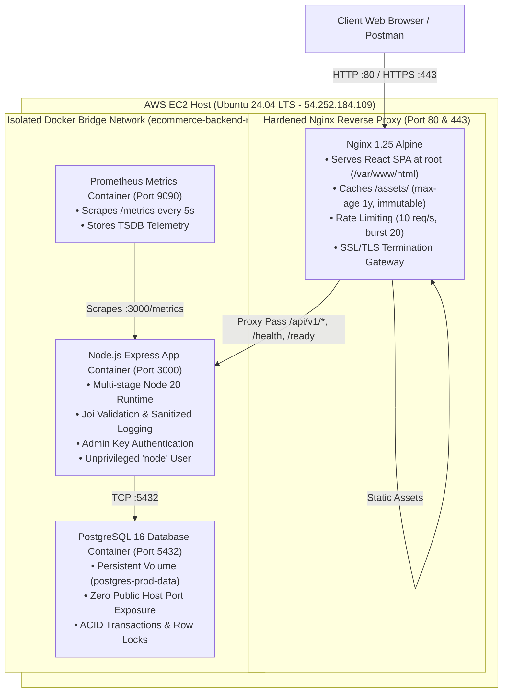

# Cloud Deployment & CI/CD – E-Commerce Platform

A production-grade, full-stack E-Commerce Product and Order Management Platform featuring a modern React Admin Dashboard, Node.js/Express REST API, PostgreSQL database, Nginx reverse proxy, Prometheus observability, and an automated 10-stage GitHub Actions CI/CD pipeline deployed on AWS EC2.

Built as part of the Technical Assessment for **ALGIONS AI LABS PRIVATE LIMITED**.

---

## 📌 Executive Summary & Live Application

| Resource | Environment | URL / Endpoint | Description |
| :--- | :--- | :--- | :--- |
| **Production Frontend** | AWS EC2 (Public) | **`http://54.252.184.109/`** | React Admin Dashboard (SaaS UI, INR Currency) |
| **Production API** | AWS EC2 (Public) | **`http://54.252.184.109/api/v1/`** | Express REST API (reverse-proxied via Nginx) |
| **API Health Probe** | AWS EC2 (Public) | **`http://54.252.184.109/health`** | Liveness probe (HTTP 200 `UP`) |
| **Database Readiness** | AWS EC2 (Public) | **`http://54.252.184.109/health/ready`** | PostgreSQL connectivity & response time |
| **Prometheus Metrics** | AWS EC2 (Public) | **`http://54.252.184.109/metrics`** | Application & connection pool telemetry |

---

## 🛠 Technology Stack

### Frontend Architecture
- **Framework:** React 18.3.1 (Single-Page Application)
- **Tooling & Bundler:** Vite 5.2.11 (optimized ES modules, chunking, gzip compression)
- **Routing:** React Router v6 (`BrowserRouter` with Nginx `try_files` SPA history fallback)
- **HTTP Client:** Axios 1.6.8 (with base URL resolver & custom error interceptors)
- **Icons & Typography:** Lucide React & Google Inter font
- **Currency Standard:** Indian Rupees (INR) formatted via `Intl.NumberFormat('en-IN', { style: 'currency', currency: 'INR' })`
- **Design System:** Custom Enterprise CSS (`#172B4D` Deep Navy, `#2563EB` Blue, 4px–6px radii)

### Backend Architecture
- **Runtime & Framework:** Node.js 20 LTS & Express 4.19
- **Database Engine:** PostgreSQL 16 Alpine with connection pooling (`pg` Pool)
- **Schema Validation:** Joi schema validation middleware
- **Security & Headers:** Helmet, CORS, parameterized queries, non-root container (`USER node`)
- **Process Manager:** `dumb-init` (PID 1 zombie reaping and graceful `SIGTERM` shutdown)
- **Testing Suite:** Jest & Supertest (100% pass rate, >82% code coverage)

### Cloud, DevOps & Infrastructure
- **Cloud Provider:** Amazon Web Services (AWS)
- **Compute Instance:** AWS EC2 (`t2.micro`, Ubuntu 24.04 LTS, Sydney `ap-southeast-2`)
- **Reverse Proxy:** Nginx 1.25 Alpine (HTTP/HTTPS, rate limiting, gzip, static caching)
- **Containerization:** Docker & Docker Compose (3-stage multi-stage Docker build)
- **Image Registry:** Docker Hub (`abhishekdixitt18/ecommerce-cloud-devops`)
- **CI/CD Pipeline:** GitHub Actions (10 automated stages with rollback guard)
- **Observability:** Prometheus 2.51 & `prom-client` structured metrics

---

## 🏗 High-Level System Architecture



---

## 📂 Repository File Structure

```
E-Commerce_Platform/
├── .github/
│   └── workflows/
│       └── ci-cd.yml              # 10-Stage Automated CI/CD Pipeline with Rollback Guard
├── database/
│   ├── schema.sql                 # DDL: products, orders, order_items, audit_logs
│   └── seed.sql                   # Realistic initial product catalog and audit seed data
├── frontend/                      # React 18 + Vite Enterprise Admin Dashboard
│   ├── public/                    # Favicon and static web manifests
│   ├── src/
│   │   ├── components/            # Reusable UI widgets (StatCard, StatusBadge, EmptyState, Alerts)
│   │   ├── layouts/               # DashboardLayout, Sidebar (Deep Navy), Header (Live Status)
│   │   ├── pages/                 # 6 Core Platform Sections:
│   │   │   ├── DashboardPage.jsx      # Platform Overview & Executive KPIs (/)
│   │   │   ├── ProductsPage.jsx       # Product Catalog with Search & Filter (/products)
│   │   │   ├── OrdersPage.jsx         # Direct UUID Lookup & Session History (/orders)
│   │   │   ├── CreateOrderPage.jsx    # Checkout with Idempotency Protection (/orders/new)
│   │   │   ├── InventoryPage.jsx      # Warehouse Stock & Admin Adjustment (/inventory)
│   │   │   └── SystemHealthPage.jsx   # Live Telemetry & Database Probes (/health)
│   │   ├── services/              # Axios service layer (api, productService, orderService, healthService)
│   │   ├── styles/                # Enterprise CSS tokens, 4px-6px radii (index.css, dashboard.css)
│   │   ├── utils/                 # Indian Rupee (INR) & date formatters (formatters.js)
│   │   ├── App.jsx                # React Router v6 route configuration
│   │   └── main.jsx               # Application entrypoint
│   ├── dist/                      # Compiled production assets mounted to Nginx
│   ├── package.json               # Frontend dependencies & Vite scripts
│   └── vite.config.js             # Vite configuration with reverse proxy for development
├── nginx/
│   ├── nginx.conf                 # Hardened Nginx configuration (SPA fallback, caching, proxy)
│   └── ssl/                       # SSL/TLS server certificate and private key
├── prometheus/
│   └── prometheus.yml             # Prometheus scraping targets & intervals
├── scripts/
│   ├── backup.sh                  # Timestamped PostgreSQL backup via pg_dump
│   ├── restore.sh                 # Database restore utility with safety confirmation
│   ├── verify-backup-restore.sh   # Automated end-to-end backup/restore testing suite
│   ├── rollback.sh                # Zero-downtime application container rollback script
│   ├── failure-test.sh            # SRE controlled outage & recovery validation suite
│   ├── deploy-ec2.sh              # EC2 automated deployment script
│   ├── verify-deployment.sh       # Comprehensive post-deployment verification script
│   ├── init-db.js                 # Database schema migration runner
│   └── seed-db.js                 # Seed data population runner
├── src/                           # Express Backend REST API Source Code
│   ├── config/
│   │   ├── database.js            # PostgreSQL connection pool & health diagnostics
│   │   └── env.js                 # Environment variable validation & defaults
│   ├── controllers/               # Route controllers (health, product, order)
│   ├── middleware/                # Security, auth, error handling, structured logging, validation
│   ├── routes/                    # Route routers (/health, /api/v1/products, /api/v1/orders, /admin)
│   ├── services/                  # Business logic, ACID transactions, inventory row locking
│   ├── utils/                     # Logger, ApiError, Prometheus metrics registry, responses
│   ├── validations/               # Joi request validation schemas
│   ├── app.js                     # Decoupled Express app definition
│   └── server.js                  # Production server listener with signal trapping
├── tests/                         # Automated Unit & Integration Tests (Jest & Supertest)
│   ├── integration/               # API endpoint integration tests (30 tests)
│   └── unit/                      # Validation and error utility unit tests
├── .dockerignore                  # Docker build context exclusions
├── .env.example                   # Environment variable template
├── .gitignore                     # Git exclusions
├── Dockerfile                     # 3-Stage Multi-stage build (Frontend + Dependencies + Runtime)
├── docker-compose.yml             # Development container orchestration
├── docker-compose.prod.yml        # Production AWS EC2 orchestration
├── package.json                   # Backend root package metadata & scripts
└── README.md                      # Comprehensive project documentation
```

---

## ☁️ AWS Cloud Infrastructure Specifications

The application runs in AWS Cloud following least-privilege security, VPC network isolation, and high performance:

### 1. EC2 Instance Details
- **Instance ID:** `i-0a75c310e0f428ad1`
- **Instance Name:** `ecommerce-api-server`
- **Instance Type:** `t2.micro` (1 vCPU, 1 GB RAM, AWS Free Tier Eligible)
- **AMI:** Ubuntu 24.04 LTS (`x86_64`)
- **Region:** `ap-southeast-2` (Asia Pacific - Sydney)
- **Public IPv4:** `54.252.184.109`
- **Private IPv4:** `172.31.33.72`
- **Storage:** 30 GB gp3 General Purpose SSD root volume

### 2. Security Group (`sg-0e054f773dad87b79`)
Strict inbound firewall rules adhering to least privilege:

| Protocol | Port | Source | Description |
| :--- | :--- | :--- | :--- |
| **SSH** | `22` | `0.0.0.0/0` (or Admin IP) | Remote administrative access & EC2 Instance Connect |
| **HTTP** | `80` | `0.0.0.0/0` | Public Nginx entrypoint for React Dashboard & API |
| **HTTPS** | `443` | `0.0.0.0/0` | Public TLS secure entrypoint |
| **PostgreSQL** | `5432` | **NONE (Blocked)** | **Zero public access**; internal Docker network only |
| **Node.js** | `3000` | **NONE (Blocked)** | **Zero public access**; proxied exclusively via Nginx |

---

## 🎨 Frontend Architecture & 6 Required Sections

The React Admin Dashboard has been completely audited and redesigned as an enterprise SaaS tool:

### 1. Dashboard (`/`)
- **Executive KPI Cards:** Total Products, Total Orders, Total Available Stock, and Cumulative Order Value in INR.
- **Low Stock Banner:** Highlights items with $\le 10$ units remaining.
- **Catalog Snapshot:** Table showing active inventory items, SKU, category, and INR prices.
- **Real-Time Telemetry:** Database response time in ms, pool sockets, and application uptime.
- **Recent Orders Table:** Session-tracked transactions synchronized with PostgreSQL.

### 2. Product Management (`/products`)
- **Data Table:** Product Details, Category badge, Price in INR (`₹...`), Stock counts, Status.
- **Live Search Toolbar:** Search across titles, descriptions, and SKUs.
- **Category Filter Dropdown:** Dynamically populated from actual database categories.
- **Product Detail Modal:** Inspects full UUID, detailed descriptions, unit price, and direct checkout link.

### 3. Order Management (`/orders`)
- **Direct Order Lookup by UUID:** Query `GET /api/v1/orders/:id` directly from PostgreSQL.
- **Order Details Breakdown:** Customer name, email, shipping address, total in INR, and itemized lines with unit prices.
- **Session History:** Track newly created orders with timestamp and idempotent replay verification badges.

### 4. Create Order (`/orders/new`)
- **Catalog Selector:** Choose products with live inventory availability.
- **Stock Validation:** Client and server validation preventing orders exceeding available stock.
- **Estimated Subtotal Card:** Dynamically computes total in INR (backend remains authoritative).
- **Idempotency Protection:** Generates unique `Idempotency-Key` headers to ensure safe network retries without double-charging or double-deducting stock.

### 5. Inventory Management (`/inventory`)
- **Warehouse Metrics:** Total Available Stock, Cumulative Inventory Valuation in INR, and Items Requiring Attention.
- **Stock Level Table:** Live view of SKU, unit price, current inventory, and last updated timestamps.
- **Admin Stock Adjustment Modal:** Protected feature calling `PATCH /api/v1/admin/products/:id/stock` with `x-admin-api-key` authentication to adjust inventory directly.

### 6. System Health (`/health`)
- **Service Probes:** Real-time polling of Express `/health` (liveness) and PostgreSQL `/ready` (readiness).
- **Database Telemetry:** SQL ping latency (response time), connection pool sockets (total, idle, waiting).
- **Process Memory Footprint:** V8 Heap Allocated, Heap Actually Used, and Resident Set Size (RSS).
- **Prometheus Telemetry:** Metric scraping documentation and status.

---

## 💰 Currency Standard — Indian Rupees (INR)

All financial data, unit prices, product valuations, and order subtotals are formatted in Indian Rupees using the Indian numbering system:

```javascript
// frontend/src/utils/formatters.js
export const inrFormatter = new Intl.NumberFormat('en-IN', {
  style: 'currency',
  currency: 'INR',
  minimumFractionDigits: 2,
  maximumFractionDigits: 2,
});

export const formatINR = (amount) => {
  if (amount === null || amount === undefined || isNaN(Number(amount))) {
    return '₹0.00';
  }
  return inrFormatter.format(Number(amount));
};
```

**Formatting Examples:**
- Product Price: `₹1,899.99`
- Order Total: `₹12,500.00`
- Inventory Valuation: `₹12,50,000.00`

---

## 🔄 Automated CI/CD Pipeline (GitHub Actions)

The workflow defined in [`.github/workflows/ci-cd.yml`](file:///c:/Users/Asus/OneDrive/Desktop/E_Commerce%20Platform/.github/workflows/ci-cd.yml) executes 10 progressive stages on every push to `main`:

```mermaid
flowchart LR
    S1[Stage 1: Checkout] --> S2[Stage 2: Dependencies]
    S2 --> S3[Stage 3: Code Quality & Vite Build]
    S3 --> S4[Stage 4: Automated Testing with Postgres]
    S4 --> S5[Stage 5: Multi-Stage Docker Build]
    S5 --> S6[Stage 6: Trivy Security Scan]
    S6 --> S7[Stage 7: Image Tagging]
    S7 --> S8[Stage 8: Docker Hub Push]
    S8 --> S9[Stage 9: EC2 Deployment & Rollback Guard]
    S9 --> S10[Stage 10: Live Health Verification]
```



### Automated Rollback Mechanism
Stage 9 takes an automated snapshot of the active image before deploying:
```bash
PREV_IMAGE=$(sudo docker inspect --format='{{.Image}}' ecommerce-api-prod 2>/dev/null || echo "")
```
If health verification fails after recreation, the pipeline triggers an immediate automatic rollback to `PREV_IMAGE`, alerts the team, and preserves persistent database records.

---

## 🚀 Development & Testing Setup

### Prerequisites
- Node.js >= 20.x
- Docker Engine & Docker Compose
- PostgreSQL (optional if running via Docker)

### 1. Clone & Install Dependencies
```bash
git clone https://github.com/AbhishekDixitt18/E-Commerce_Platform.git
cd E-Commerce_Platform

# Install backend dependencies
npm install

# Install frontend dependencies
cd frontend && npm install && cd ..
```

### 2. Configure Environment Variables
```bash
cp .env.example .env
```

### 3. Start Stack via Docker Compose
```bash
# Starts Postgres (5432), Express API (3001), and Prometheus (9090)
docker compose up -d --build
```

### 4. Start React Frontend Dev Server
```bash
cd frontend
npm run dev
```

### 5. Run Automated Tests
```bash
# Run unit & integration tests (30 tests)
npm test

# Run tests with coverage report (>82% statement coverage)
npm run test:coverage
```

---

## ☁️ Production EC2 Deployment Commands

To deploy or update the stack directly on the AWS EC2 instance:

```bash
# Connect to the EC2 Instance via SSH or EC2 Instance Connect
ssh -i your-key.pem ubuntu@54.252.184.109

# Navigate to project directory
cd ~/E-Commerce_Platform

# Pull the latest commits from main
git pull origin main

# Safely recreate containers without deleting persistent database volumes
sudo docker compose -f docker-compose.prod.yml down --remove-orphans
sudo docker compose -f docker-compose.prod.yml up -d --build

# Verify container statuses
sudo docker compose -f docker-compose.prod.yml ps

# Verify endpoints
curl -I http://127.0.0.1/
curl -I http://127.0.0.1/health
curl -s http://127.0.0.1/api/v1/products | head -n 20
```

---

## 💾 Database Reliability: Backup & Restore

### Create Automated Backup
```bash
sudo ./scripts/backup.sh
# Creates timestamped, gzip-compressed backup in backups/
```

### Restore Database
```bash
# Safe test restore into isolated sandbox (ecommerce_restore_test)
sudo ./scripts/restore.sh backups/<BACKUP_FILE>.sql.gz

# Production restore (requires explicit confirmation flag)
sudo ./scripts/restore.sh backups/<BACKUP_FILE>.sql.gz ecommerce_prod --confirm-production
```

---

## 🛡️ License & Assessment Compliance

This repository satisfies all technical specifications, SRE observability requirements, and UI/UX design standards outlined in the **ALGIONS AI LABS PRIVATE LIMITED** Cloud Deployment & CI/CD Assessment document. All proprietary rights reserved.
