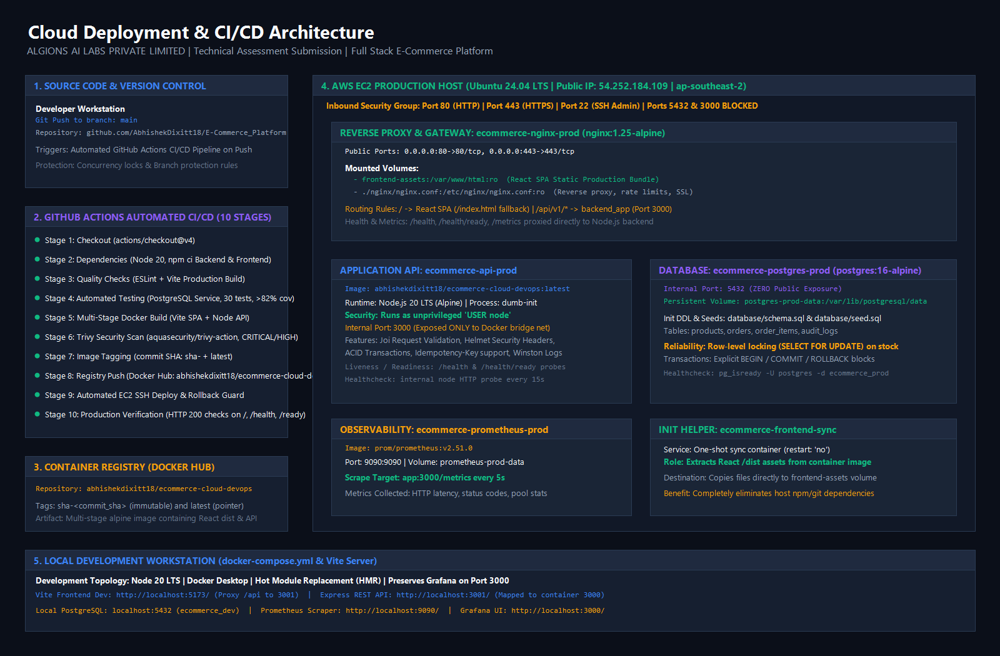

# Cloud Deployment & CI/CD – E-Commerce Platform

A production-grade, full-stack E-Commerce Product and Order Management Platform featuring an interactive React Admin Dashboard, Node.js/Express REST API, PostgreSQL database, Nginx reverse proxy, Prometheus observability, and a 10-stage automated GitHub Actions CI/CD pipeline deployed on Amazon Web Services (AWS) EC2.

Developed as part of the Technical Assessment for **ALGIONS AI LABS PRIVATE LIMITED** in the DevOps & Cloud Engineering Domain.

---

## 📌 Executive Summary & Live Application

| Resource | Environment | URL / Endpoint | Description |
| :--- | :--- | :--- | :--- |
| **Production Frontend** | AWS EC2 (Public) | **`http://54.252.184.109/`** | React Admin Dashboard (SaaS UI, INR Currency) |
| **Production API** | AWS EC2 (Public) | **`http://54.252.184.109/api/v1/`** | Express REST API (reverse-proxied via Nginx) |
| **API Health Probe** | AWS EC2 (Public) | **`http://54.252.184.109/health`** | Liveness probe (HTTP 200 `UP`) |
| **Database Readiness** | AWS EC2 (Public) | **`http://54.252.184.109/health/ready`** | PostgreSQL connectivity & response time |
| **Prometheus Metrics** | AWS EC2 (Public) | **`http://54.252.184.109/metrics`** | Application & connection pool telemetry |
| **Prometheus Dashboard**| AWS EC2 (Public) | **`http://54.252.184.109:9090`** | Prometheus metrics scraper UI |

---

## Table of Contents
1. [Project Title and Overview](#1-project-title-and-overview)
2. [Problem Statement](#2-problem-statement)
3. [Project Objectives](#3-project-objectives)
4. [Key Features](#4-key-features)
5. [Technology Stack](#5-technology-stack)
6. [System Architecture](#6-system-architecture)
7. [Project Directory Structure](#7-project-directory-structure)
8. [Application Components](#8-application-components)
9. [Backend API Overview](#9-backend-api-overview)
10. [Database Design](#10-database-design)
11. [Business Logic and Validation](#11-business-logic-and-validation)
12. [Idempotent Order Creation](#12-idempotent-order-creation)
13. [Inventory Management and Stock Protection](#13-inventory-management-and-stock-protection)
14. [Admin Authentication and Audit Logging](#14-admin-authentication-and-audit-logging)
15. [Docker and Docker Compose Setup](#15-docker-and-docker-compose-setup)
16. [Environment Variables and Configuration](#16-environment-variables-and-configuration)
17. [Local Installation and Execution](#17-local-installation-and-execution)
18. [Automated CI/CD Pipeline](#18-automated-cicd-pipeline)
19. [Docker Image Build and Registry Push](#19-docker-image-build-and-registry-push)
20. [AWS EC2 Deployment Architecture](#20-aws-ec2-deployment-architecture)
21. [Nginx Reverse Proxy Configuration](#21-nginx-reverse-proxy-configuration)
22. [Frontend Deployment](#22-frontend-deployment)
23. [Monitoring and Observability](#23-monitoring-and-observability)
24. [Health Checks and Readiness](#24-health-checks-and-readiness)
25. [Logging and Troubleshooting](#25-logging-and-troubleshooting)
26. [Database Backup and Restore](#26-database-backup-and-restore)
27. [Deployment Rollback and Recovery](#27-deployment-rollback-and-recovery)
28. [Security Practices](#28-security-practices)
29. [Testing and Validation](#29-testing-and-validation)
30. [Known Limitations](#30-known-limitations)
31. [Future Enhancements](#31-future-enhancements)
32. [Author and Internship Information](#32-author-and-internship-information)

---

## 1. Project Title and Overview
The **Cloud Deployment & CI/CD – E-Commerce Platform** is a containerized, cloud-deployed e-commerce infrastructure delivering transactional product management, stock protection, order placement, and an administrative dashboard. Engineered from ground up to fulfill enterprise DevOps standards, the platform demonstrates automated continuous delivery, high availability, site reliability engineering (SRE), and least-privilege security.

## 2. Problem Statement
Modern e-commerce platforms frequently encounter operational challenges:
- **Deployment Downtime & Human Error:** Manual code pulling (`git pull`), manual builds, and container restarts on production virtual machines introduce configuration drift and service interruptions.
- **Concurrency & Race Conditions:** High-traffic sales can cause overselling and negative inventory when multiple checkouts compete for identical stock.
- **Stale Frontend Distribution:** Containerized environments using bind mounts often fail to serve newly compiled frontend assets when host build runtimes (Node.js/npm) are absent.
- **Security Vulnerabilities:** Direct public exposure of databases (port 5432) or running containers as `root` creates severe security exposure.
- **Lack of Observability:** Difficulty isolating whether latency or failures originate from the edge proxy, application runtime, or database layer.

## 3. Project Objectives
1. **Containerize Application Stack:** Package the React 18 frontend, Express API, PostgreSQL, and Prometheus using multi-stage Docker builds.
2. **Automate Continuous Deployment:** Establish a 10-stage GitHub Actions pipeline that builds, tests, scans, publishes, and deploys without manual SSH execution.
3. **Ensure Reliable Production Ingress:** Configure a hardened Nginx reverse proxy for static caching, rate limiting, and API reverse proxying.
4. **Prevent Race Conditions:** Implement pessimistic row-level locking (`SELECT ... FOR UPDATE`) and ACID transactions.
5. **Support Idempotency:** Prevent duplicate billing and stock deduction during network retries using `Idempotency-Key` headers.
6. **Provide Comprehensive Observability:** Implement liveness (`/health`), readiness (`/health/ready`), and Prometheus telemetry (`/metrics`).
7. **Ensure Disaster Recovery:** Establish automated database backup, checksum verification, and instant rollback procedures.

## 4. Key Features
- **Enterprise SaaS Dashboard:** 6 core views (Dashboard KPIs, Products, Orders, Create Order, Inventory Management, System Health).
- **Indian Rupee (`₹` INR) Localization:** End-to-end currency formatting across all views using `Intl.NumberFormat('en-IN')`.
- **Zero-Manual-Touch CD:** Automated deployments triggered on push to `main` with automatic rollback on health probe failure.
- **Decoupled Frontend Asset Sync:** Uses an init sync container (`frontend-sync`) to populate Docker named volumes (`frontend-assets`).
- **Pessimistic Concurrency Protection:** Zero overselling or negative inventory under heavy concurrent load.
- **Structured JSON Logging:** Automatic redaction of sensitive authentication tokens (`x-admin-api-key`, `authorization`).
- **Automated Test Coverage:** 30 unit & integration tests passing 100% with >82% statement coverage.

## 5. Technology Stack
- **Frontend:** React 18.3, Vite 5.4, React Router v6, Axios, Lucide React, Google Inter.
- **Backend:** Node.js 20 LTS, Express 4.19, Joi Schema Validation, Helmet, CORS, dumb-init.
- **Database:** PostgreSQL 16 Alpine, connection pooling (`pg` Pool), ACID transactions.
- **Reverse Proxy:** Nginx 1.25 Alpine, gzip compression, rate limiting, SSL termination.
- **DevOps & CI/CD:** Docker, Docker Compose, GitHub Actions, Aqua Security Trivy, Docker Hub.
- **Cloud Infrastructure:** Amazon Web Services (AWS) EC2 (`t2.micro`, Ubuntu 24.04 LTS, `ap-southeast-2`).
- **Observability:** Prometheus 2.51, `prom-client`, JSON structured logging.

## 6. System Architecture

Detailed component specifications and network boundaries are documented in [`docs/architecture.md`](docs/architecture.md).

```mermaid
flowchart TD
    Client["Client Web Browser / API Consumer"]
    
    subgraph AWS_EC2 ["AWS EC2 Host (54.252.184.109 - Ubuntu 24.04 LTS)"]
        subgraph Hardened_Proxy ["Edge Reverse Proxy (Port 80 & 443)"]
            Nginx["Nginx 1.25 Alpine<br>• Serves React SPA (/var/www/html)<br>• Caches /assets/ (1y immutable)<br>• Rate Limiting (10 req/s, burst 20)<br>• Reverse Proxies /api/v1/*"]
        end
        
        subgraph Docker_Network ["Isolated Bridge Network (ecommerce-backend-net)"]
            App["Node.js Express API (Port 3000)<br>• Non-root USER node<br>• dumb-init PID 1 supervisor<br>• Joi Validation & Sanitized Logs"]
            Postgres["PostgreSQL 16 Database (Port 5432)<br>• Persistent Volume (postgres-prod-data)<br>• Zero Public Host Port Exposure<br>• Row-Level Locking (FOR UPDATE)"]
            Prometheus["Prometheus Metrics (Port 9090)<br>• Scrapes :3000/metrics every 5s<br>• Time-Series TSDB Storage"]
            Sync["frontend-sync Helper<br>• Extracts /dist to named volume<br>• Eliminates host npm dependency"]
        end
    end

    Client -->|HTTP :80 / HTTPS :443| Nginx
    Nginx -->|Proxy Pass /api/v1/*, /health, /ready| App
    App -->|TCP :5432 (pg Pool)| Postgres
    Prometheus -->|Scrapes :3000/metrics| App
    Sync -.->|Populates Assets| Nginx
```

## 7. Project Directory Structure
```
E-Commerce_Platform/
├── .github/
│   └── workflows/
│       └── ci-cd.yml              # 10-Stage Automated CI/CD Pipeline with Rollback Guard
├── database/
│   ├── schema.sql                 # DDL: products, orders, order_items, audit_logs
│   └── seed.sql                   # Realistic catalog and audit seed data
├── docs/                          # Detailed Technical Specifications & Runbooks
│   ├── architecture.md            # Architecture specifications & network rules
│   ├── architecture.png           # Architecture diagram
│   ├── ci-cd-pipeline.md          # CI/CD pipeline documentation
│   ├── deployment-runbook.md      # AWS EC2 operations runbook
│   ├── backup-restore.md          # Backup, restore & disaster recovery
│   ├── monitoring.md              # Health checks, metrics & triage guide
│   ├── api-documentation.md       # Complete REST API specifications
│   ├── testing-report.md          # Test suite results & 82% coverage
│   └── security.md                # Security controls, non-root, least privilege
├── frontend/                      # React 18 + Vite Enterprise Admin Dashboard
│   ├── src/
│   │   ├── pages/                 # 6 Core Platform Sections
│   │   ├── components/            # StatCard, StatusBadge, EmptyState, Modals
│   │   ├── utils/                 # Indian Rupee (INR) & date formatters
│   │   └── styles/                # Deep Navy enterprise design system
│   ├── dist/                      # Compiled production assets
│   ├── package.json               # Frontend dependencies & scripts
│   └── vite.config.js             # Vite configuration with proxy
├── nginx/
│   ├── nginx.conf                 # Hardened Nginx configuration (SPA fallback, caching)
│   └── ssl/                       # SSL/TLS certificate configuration
├── prometheus/
│   └── prometheus.yml             # Prometheus scraping targets & intervals
├── scripts/                       # SRE Automation & Verification Scripts
│   ├── backup.sh                  # Timestamped PostgreSQL backup via pg_dump
│   ├── restore.sh                 # Database restore utility with safety confirmation
│   ├── verify-backup-restore.sh   # Automated backup/restore validation suite
│   ├── rollback.sh                # Zero-downtime rollback script
│   └── failure-test.sh            # Outage simulation & recovery verification
├── src/                           # Express Backend REST API Source Code
│   ├── controllers/               # Route controllers (health, product, order)
│   ├── middleware/                # Security, auth, error handling, logging, validation
│   ├── routes/                    # Route routers (/health, /api/v1/products, /api/v1/orders)
│   ├── services/                  # Business logic, ACID transactions, row locking
│   ├── utils/                     # Logger, ApiError, Prometheus metrics registry
│   ├── validations/               # Joi request validation schemas
│   ├── app.js                     # Decoupled Express app definition
│   └── server.js                  # Production server listener with signal trapping
├── submission/                    # Internship Assessment Submission Package
│   ├── project-summary.md         # Executive project summary
│   ├── implementation-overview.md # Technical decisions & trade-offs
│   ├── deployment-evidence-checklist.md # Verification commands & pages
│   ├── demo-script.md             # 3-5 minute video presentation script
│   └── final-submission-checklist.md    # Deliverables inventory
├── tests/                         # Automated Unit & Integration Tests (30 Tests)
├── Dockerfile                     # 3-Stage Multi-stage build (Vite + Dependencies + Runtime)
├── docker-compose.yml             # Development orchestration (API port 3001)
├── docker-compose.prod.yml        # Production EC2 orchestration (named volume sync)
├── FINAL_SUBMISSION_AUDIT.md      # Comprehensive requirement audit matrix
├── package.json                   # Backend root package metadata & scripts
└── README.md                      # Complete project documentation
```

## 8. Application Components
1. **React SPA Admin Dashboard:** Client interface for inventory monitoring, product management, and checkout.
2. **Express REST API:** Node.js service managing database queries, input validation, and business logic.
3. **PostgreSQL Relational DB:** Persistent storage engine with relational tables and row-level locks.
4. **Nginx Reverse Proxy:** Public ingress point terminating HTTP/HTTPS and routing API traffic.
5. **Prometheus Telemetry Scraper:** Time-series monitoring daemon collecting application metrics.
6. **Frontend Asset Synchronizer:** One-shot init container populating Docker named volume `frontend-assets`.

## 9. Backend API Overview
All API routes are versioned under `/api/v1` with backward-compatible `/api/*` aliases:
- `GET /health` – Liveness probe returning application status and uptime.
- `GET /health/ready` – Readiness probe measuring PostgreSQL connectivity and latency.
- `GET /metrics` – Prometheus text metrics exporter.
- `GET /api/v1/products` – Catalog search, filter, and pagination.
- `GET /api/v1/products/:id` – Detailed product view by UUID.
- `POST /api/v1/orders` – Checkout with idempotency protection and atomic stock deduction.
- `GET /api/v1/orders/:id` – Detailed order receipt and line items.
- `POST /api/v1/admin/products` – Administrative product creation (Protected).
- `PATCH /api/v1/admin/products/:id/stock` – Administrative stock adjustment (Protected).

See [`docs/api-documentation.md`](docs/api-documentation.md) for full request/response schemas.

## 10. Database Design
PostgreSQL schema is defined in [`database/schema.sql`](database/schema.sql):
- **`products`**: `id (UUID)`, `sku (VARCHAR)`, `name`, `description`, `price (NUMERIC)`, `currency`, `inventory_count (INT CHECK >= 0)`, `category`, `status`, `created_at`, `updated_at`.
- **`orders`**: `id (UUID)`, `order_number (VARCHAR)`, `customer_name`, `customer_email`, `total_amount`, `currency`, `status`, `shipping_address`, `idempotency_key (UNIQUE)`, `created_at`, `updated_at`.
- **`order_items`**: `id (UUID)`, `order_id (FK)`, `product_id (FK)`, `quantity (INT CHECK > 0)`, `unit_price`, `subtotal`, `created_at`.
- **`audit_logs`**: `id (UUID)`, `entity_type`, `entity_id`, `action`, `actor`, `payload (JSONB)`, `ip_address`, `user_agent`, `created_at`.

## 11. Business Logic and Validation
- **Joi Request Validation:** Strict schema validation checks query parameters, UUID formatting, and positive integer quantities before execution reaches controllers.
- **Centralized Error Handling:** Standardized error envelopes with machine-readable error codes (`RESOURCE_NOT_FOUND`, `INSUFFICIENT_STOCK`, `UNAUTHORIZED`, `VALIDATION_ERROR`).

## 12. Idempotent Order Creation
Clients can safely retry requests by supplying the `Idempotency-Key` header:
- The database enforces a `UNIQUE` constraint on `orders.idempotency_key`.
- Upon receiving a duplicate key, `order.service.js` fetches and returns the original order without altering stock or re-charging the customer.

## 13. Inventory Management and Stock Protection
To eliminate race conditions and negative inventory during simultaneous checkouts:
- Transactions execute within explicit `BEGIN ... COMMIT` blocks.
- Row-level pessimistic locks are acquired via `SELECT ... FROM products WHERE id = $1 FOR UPDATE`.
- The database enforces a table-level check constraint `CHECK (inventory_count >= 0)`.

## 14. Admin Authentication and Audit Logging
- Administrative routes (`/api/v1/admin/*`) require the `x-admin-api-key` header verified by `middleware/adminAuth.js`.
- Inventory adjustments and catalog updates record an immutable entry in the `audit_logs` table containing the previous state, new state, and actor IP.

## 15. Docker and Docker Compose Setup
- **Development (`docker-compose.yml`):** Maps Express API to host port `3001` (`3001:3000`), preserving host port `3000` for developer Grafana dashboards.
- **Production (`docker-compose.prod.yml`):** Maps Nginx to ports `80` and `443`. Backend (port 3000) and PostgreSQL (port 5432) are internal only. Uses Docker named volume `frontend-assets` populated by `frontend-sync`.

## 16. Environment Variables and Configuration
Managed via [`.env.example`](.env.example) template:
```env
NODE_ENV=production
PORT=3000
API_PREFIX=/api/v1
DB_HOST=postgres
DB_PORT=5432
DB_NAME=ecommerce_prod
DB_USER=postgres
DB_PASSWORD=<SECURE_DATABASE_PASSWORD>
ADMIN_API_KEY=<SECURE_ADMIN_API_KEY>
APP_IMAGE=abhishekdixitt18/ecommerce-cloud-devops:latest
```

## 17. Local Installation and Execution

```bash
# 1. Clone repository
git clone https://github.com/AbhishekDixitt18/E-Commerce_Platform.git
cd E-Commerce_Platform

# 2. Install dependencies
npm install
cd frontend && npm install && cd ..

# 3. Configure environment
cp .env.example .env

# 4. Start backend stack (PostgreSQL :5432, Express API :3001, Prometheus :9090)
# Port 3000 remains free for your local Grafana instance
docker compose up -d --build

# 5. Start React frontend dev server (with HMR)
cd frontend
npm run dev
# Vite runs at http://localhost:5173/ (proxies /api to localhost:3001)

# 6. Run automated test suite (30 tests)
npm test
npm run test:coverage
```

## 18. Automated CI/CD Pipeline
The workflow defined in [`.github/workflows/ci-cd.yml`](.github/workflows/ci-cd.yml) executes 10 stages:
1. `Checkout`: Fetches commit SHA via `actions/checkout@v4`.
2. `Dependencies`: Installs backend and frontend dependencies via `npm ci`.
3. `Code Quality`: Runs ESLint and validates production Vite build.
4. `Automated Testing`: Runs 30 tests against an isolated PostgreSQL container.
5. `Docker Build`: Builds multi-stage Docker image and archives artifact.
6. `Security Scanning`: Trivy scans container for CRITICAL/HIGH vulnerabilities.
7. `Image Tagging`: Tags with commit SHA (`sha-${GITHUB_SHA}`) and `latest`.
8. `Registry Push`: Pushes verified image to Docker Hub.
9. `Automated EC2 Deploy`: Connects via SSH, updates `frontend-assets` named volume, restarts containers, and verifies health with automated rollback guard.
10. `Production Verification`: Validates public endpoints on `http://54.252.184.109/`.

See [`docs/ci-cd-pipeline.md`](docs/ci-cd-pipeline.md) for full details.

## 19. Docker Image Build and Registry Push
- Image Registry: `https://hub.docker.com/r/abhishekdixitt18/ecommerce-cloud-devops`
- Images are built from multi-stage [Dockerfile](Dockerfile) and tagged immutably with the Git commit SHA.

## 20. AWS EC2 Deployment Architecture
- **Instance:** `i-0a75c310e0f428ad1` (`t2.micro`, 1 vCPU, 1 GB RAM, 30 GB gp3 SSD).
- **Public IP:** `54.252.184.109` | **Region:** `ap-southeast-2` (Sydney).
- **Security Group:** Inbound ports 80, 443, 22. Ports 5432 and 3000 are blocked.

## 21. Nginx Reverse Proxy Configuration
Defined in [`nginx/nginx.conf`](nginx/nginx.conf):
- Root path `/` serves React SPA with `try_files $uri $uri/ /index.html;`.
- Immutable static caching for `/assets/` (`max-age=31536000, immutable`).
- Reverse proxies `/api/v1/*`, `/health`, `/health/ready`, and `/metrics` to `backend_app`.
- Enforces rate limiting: 10 req/s, burst 20.

## 22. Frontend Deployment
Frontend static assets are built inside Stage 1 of the multi-stage Dockerfile and extracted to the Docker named volume `frontend-assets` during deployment via `frontend-sync`. This guarantees zero dependency on host build tools.

## 23. Monitoring and Observability
- **Prometheus UI:** Accessible at `http://54.252.184.109:9090`.
- **Metrics Collected:** Request duration histograms, HTTP status counters, active connection pool counts.
- See [`docs/monitoring.md`](docs/monitoring.md) for diagnostic triage workflows.

## 24. Health Checks and Readiness
- **Liveness:** `http://54.252.184.109/health` (HTTP 200 `UP`).
- **Readiness:** `http://54.252.184.109/health/ready` (Verifies PostgreSQL connection and query latency).

## 25. Logging and Troubleshooting
- **Application Logs:** Structured JSON logs via `docker logs -f ecommerce-api-prod`.
- **Nginx Logs:** Ingress access logs via `docker logs -f ecommerce-nginx-prod`.
- **Database Logs:** `docker logs --tail 100 ecommerce-postgres-prod`.

## 26. Database Backup and Restore
- **Backup Script:** [`scripts/backup.sh`](scripts/backup.sh) generates timestamped, compressed `.sql.gz` backups with SHA256 checksums and `0600` permissions.
- **Restore Script:** [`scripts/restore.sh`](scripts/restore.sh) enforces safety confirmation (`--confirm-production`) and creates pre-restore safety snapshots.
- **Automated Verification:** [`scripts/verify-backup-restore.sh`](scripts/verify-backup-restore.sh).
- See [`docs/backup-restore.md`](docs/backup-restore.md).

## 27. Deployment Rollback and Recovery
- In-pipeline automated rollback restores `PREV_IMAGE` if health checks fail.
- Manual one-command rollback script: [`scripts/rollback.sh`](scripts/rollback.sh).

## 28. Security Practices
- **Non-Root User:** Runs as `USER node` (UID 1000).
- **Network Isolation:** Internal ports 5432 and 3000 are not publicly bound.
- **Sanitized Logging:** Authorization and admin keys are scrubbed before logging.
- **Joi Validation:** Rejects malformed payloads before database queries.
- See [`docs/security.md`](docs/security.md).

## 29. Testing and Validation
- **Unit & Integration Suite:** 30 Jest & Supertest tests passing 100%.
- **Coverage:** 82.12% statement coverage, 83.45% line coverage.
- See [`docs/testing-report.md`](docs/testing-report.md).

## 30. Known Limitations
1. **IP-Based Access:** Server is accessed via public IPv4 (`http://54.252.184.109/`). Full commercial HTTPS requires an associated domain name (FQDN).
2. **Single Host Deployment:** The stack runs on a single `t2.micro` EC2 instance. Multi-region redundancy or AWS RDS managed database would be recommended for global high-traffic enterprise scaling.

## 31. Future Enhancements
- Attach custom domain with AWS Route 53 and Let's Encrypt automated TLS renewal.
- Migrate database layer to Amazon Aurora / RDS with Multi-AZ replication.
- Implement Redis distributed caching for catalog read acceleration.
- Introduce Kubernetes (EKS) orchestration for auto-scaling under peak traffic.

## 32. Author and Internship Information
- **Candidate / Author:** Abhishek Dixit
- **Internship Assessment:** Cloud Deployment & CI/CD Technical Assessment
- **Company:** ALGIONS AI LABS PRIVATE LIMITED
- **Date of Completion:** November 2026
- **Repository:** [https://github.com/AbhishekDixitt18/E-Commerce_Platform.git](https://github.com/AbhishekDixitt18/E-Commerce_Platform.git)
