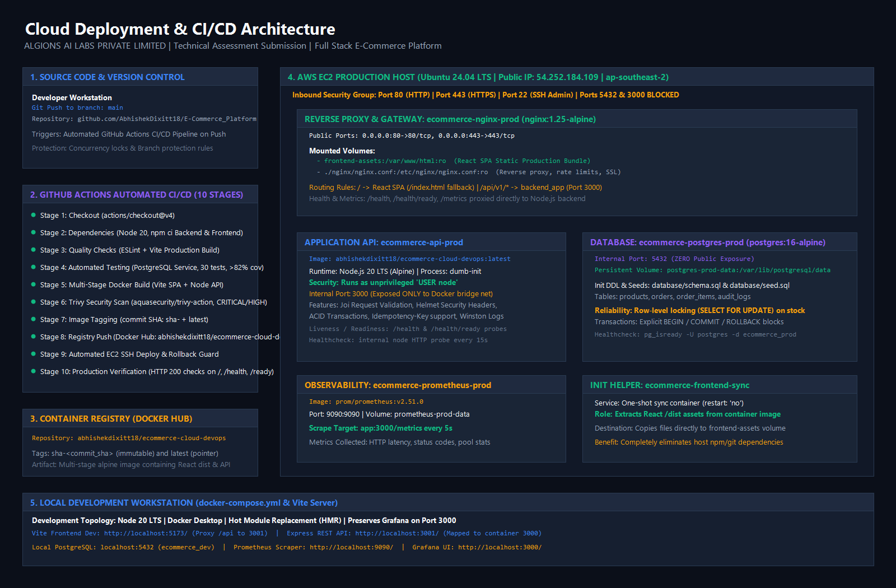
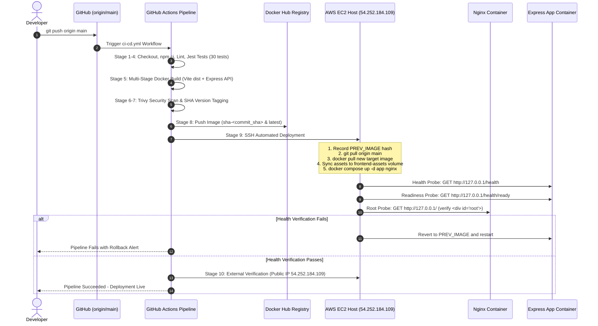

# System Architecture & Technical Specifications

**Company:** ALGIONS AI LABS PRIVATE LIMITED  
**Project:** Cloud Deployment & CI/CD – E-Commerce Platform  
**Domain:** DevOps & Cloud Engineering  
**Version:** 1.0.0 (Production Verified)

---

## 1. Architectural Overview

The **E-Commerce Cloud DevOps Platform** is designed as a distributed, decoupled, containerized multi-tier web application running in production on Amazon Web Services (AWS) EC2. The platform combines a responsive Single Page Application (SPA) frontend developed in React 18, a high-performance RESTful API backend built on Node.js and Express, an ACID-compliant PostgreSQL database engine, and a hardened Nginx reverse proxy acting as the edge security perimeter.

Observability is maintained through Prometheus structured telemetry scraping, while automated continuous delivery is orchestrated via a 10-stage GitHub Actions pipeline featuring automated SSH deployment, Docker volume synchronization, and instant health-check rollback protection.



---

## 2. Component Breakdown & Responsibilities

### 2.1 Edge Reverse Proxy: Nginx 1.25 Alpine
- **Container Name:** `ecommerce-nginx-prod`
- **Host Ports:** `80:80` (HTTP) and `443:443` (HTTPS)
- **Primary Responsibilities:**
  1. **Edge Traffic Termination & Ingress:** Serves as the sole public-facing web server for the entire cloud environment.
  2. **React SPA Static Asset Delivery:** Serves the compiled React 18 / Vite distribution files (`index.html`, JavaScript chunks, CSS stylesheets, SVGs) from an isolated Docker named volume (`frontend-assets:/var/www/html:ro`).
  3. **Client-Side History Fallback:** Employs `try_files $uri $uri/ /index.html;` to seamlessly support React Router v6 client-side routing.
  4. **API Reverse Proxying:** Proxies `/api/v1/*` requests to the internal Node.js container (`http://backend_app`) over an internal Docker bridge network.
  5. **Direct Probe Routing:** Forwards `/health`, `/health/ready`, and `/metrics` directly to the backend application container.
  6. **Static Asset Caching:** Configures immutable, 1-year client caching (`max-age=31536000, immutable`) for hashed Vite bundle assets located in `/assets/`.
  7. **Security Hardening & Rate Limiting:** Enforces request rate limits (`limit_req_zone $binary_remote_addr zone=api_limit:10m rate=10r/s`), hides version signatures (`server_tokens off`), and terminates SSL/TLS.

### 2.2 Application REST API: Node.js 20 Express
- **Container Name:** `ecommerce-api-prod`
- **Internal Port:** `3000` (Zero public host exposure)
- **Primary Responsibilities:**
  1. **RESTful Business Operations:** Exposes validated endpoints for catalog browsing, order placement, stock verification, and administrative adjustments.
  2. **Security & Least Privilege:** Enforces non-root execution (`USER node`) and process supervision using `dumb-init` (handling PID 1 signal forwarding and zombie process reaping).
  3. **Strict Schema Validation:** Utilizes Joi validation middleware to inspect incoming request headers, query parameters, route parameters, and JSON payloads.
  4. **Idempotent Order Creation:** Supports `Idempotency-Key` headers on `POST /api/v1/orders` to prevent double-charging or duplicate inventory deduction during network retries.
  5. **Telemetry & Structured Logging:** Exposes `/metrics` for Prometheus scraping, and outputs JSON-formatted structured access logs with automatic sanitization of sensitive authentication headers.

### 2.3 Database Engine: PostgreSQL 16 Alpine
- **Container Name:** `ecommerce-postgres-prod`
- **Internal Port:** `5432` (Zero public host exposure; strictly bound to `ecommerce-backend-net`)
- **Primary Responsibilities:**
  1. **Relational Persistence:** Persists critical business tables (`products`, `orders`, `order_items`, `audit_logs`) across container lifecycles via the Docker named volume `postgres-prod-data:/var/lib/postgresql/data`.
  2. **Concurrency & Race Condition Prevention:** Executes product stock deductions inside explicit database transactions using pessimistic row-level locking (`SELECT ... FOR UPDATE`).
  3. **Audit Trail Immutability:** Records transactional domain events, administrative price/stock updates, and actor metadata in `audit_logs`.
  4. **Health Diagnostics:** Continuously probed via native `pg_isready -U postgres -d ecommerce_prod`.

### 2.4 Frontend Asset Sync Helper: `ecommerce-frontend-sync`
- **Container Name:** `ecommerce-frontend-sync`
- **Execution Mode:** One-shot init task (`restart: "no"`)
- **Primary Responsibilities:**
  1. **Decoupled Asset Distribution:** When new Docker images are deployed, extracts `/usr/src/app/frontend/dist` directly from the newly pulled `abhishekdixitt18/ecommerce-cloud-devops` image into the shared named volume `frontend-assets`.
  2. **Host Independence:** Eliminates any dependency on host-level `git pull`, Node.js, or npm on the production EC2 virtual machine.

### 2.5 Observability Engine: Prometheus 2.51
- **Container Name:** `ecommerce-prometheus-prod`
- **Host Port:** `9090:9090`
- **Primary Responsibilities:**
  1. **Time-Series Telemetry Collection:** Scrapes `http://app:3000/metrics` every 5 seconds.
  2. **Storage:** Retains time-series database metrics in `prometheus-prod-data:/prometheus`.

---

## 3. Network Architecture & Security Boundaries

```mermaid
flowchart TD
    Client["Public Client (Web Browser / API Consumer)"]
    
    subgraph AWS_Cloud ["AWS Cloud (Sydney ap-southeast-2)"]
        subgraph EC2_VM ["AWS EC2 Host (Ubuntu 24.04 LTS - 54.252.184.109)"]
            subgraph Security_Group ["EC2 Security Group (sg-0e054f773dad87b79)"]
                Port80["Port 80 (HTTP Inbound)"]
                Port443["Port 443 (HTTPS Inbound)"]
                Port22["Port 22 (SSH Admin Inbound)"]
                BlockedPorts["Ports 5432 & 3000 (BLOCKED)"]
            end
            
            subgraph Docker_Bridge ["Docker Bridge Network (ecommerce-backend-net)"]
                Nginx["Nginx Reverse Proxy Container<br>(ecommerce-nginx-prod)"]
                Sync["Frontend Sync Container<br>(ecommerce-frontend-sync)"]
                NodeApp["Node.js Express API Container<br>(ecommerce-api-prod :3000)"]
                Postgres["PostgreSQL 16 Container<br>(ecommerce-postgres-prod :5432)"]
                Prometheus["Prometheus Metrics Container<br>(ecommerce-prometheus-prod :9090)"]
            end
            
            subgraph Named_Volumes ["Docker Persistent Named Volumes"]
                VolFront["frontend-assets"]
                VolPG["postgres-prod-data"]
                VolProm["prometheus-prod-data"]
            end
        end
    end

    Client -->|HTTP / HTTPS| Port80
    Client -->|HTTPS| Port443
    Port80 --> Nginx
    Port443 --> Nginx
    
    Sync -->|Copies /dist| VolFront
    VolFront -->|Mounted /var/www/html| Nginx
    Nginx -->|Proxy Pass /api/v1/*, /health, /ready| NodeApp
    NodeApp -->|TCP :5432 (pg Pool)| Postgres
    Postgres -->|Read / Write Data| VolPG
    Prometheus -->|Scrapes :3000/metrics| NodeApp
    Prometheus -->|Stores TSDB| VolProm
```

### 3.1 Network Isolation Rules
1. **Public Subnet Isolation:** Only ports 80, 443, and 22 are permitted through the AWS Security Group.
2. **Internal Network Bridging:** The Node.js Express application container and PostgreSQL database communicate strictly through the internal Docker bridge network `ecommerce-backend-net`.
3. **Database Security:** Host port 5432 is **never** bound to `0.0.0.0`. PostgreSQL cannot be accessed from outside the EC2 host.
4. **Backend Application Security:** Host port 3000 is **never** bound publicly in production. Client requests must pass through Nginx where rate limiting, header sanitization, and request validation are enforced.

---

## 4. End-to-End Deployment Flow



---

## 5. Local Workstation vs. Production EC2 Configuration

To preserve developer productivity and avoid port conflicts with developer tools, the configuration is strictly partitioned:

| Attribute | Local Workstation (`docker-compose.yml`) | Production AWS EC2 (`docker-compose.prod.yml`) |
| :--- | :--- | :--- |
| **Frontend Access** | `http://localhost:5173/` (Vite dev server) | `http://54.252.184.109/` (Nginx serving compiled bundle) |
| **Backend API Host Port** | `3001` (`3001:3000` mapping) | Internal only (Proxied via Nginx on `80/443`) |
| **Grafana Compatibility** | Host port `3000` preserved for Grafana | Port 3000 internal to Docker network |
| **PostgreSQL Database** | Host port `5432:5432` (`ecommerce_dev`) | Internal only (5432, `ecommerce_prod`) |
| **Frontend Distribution** | Local Vite hot module reloading | Docker named volume `frontend-assets` |
| **Process Model** | `node src/server.js` | Multi-stage Docker image with `dumb-init` |
| **SSL / TLS** | HTTP / Self-signed certificate | Nginx reverse proxy with SSL termination |
