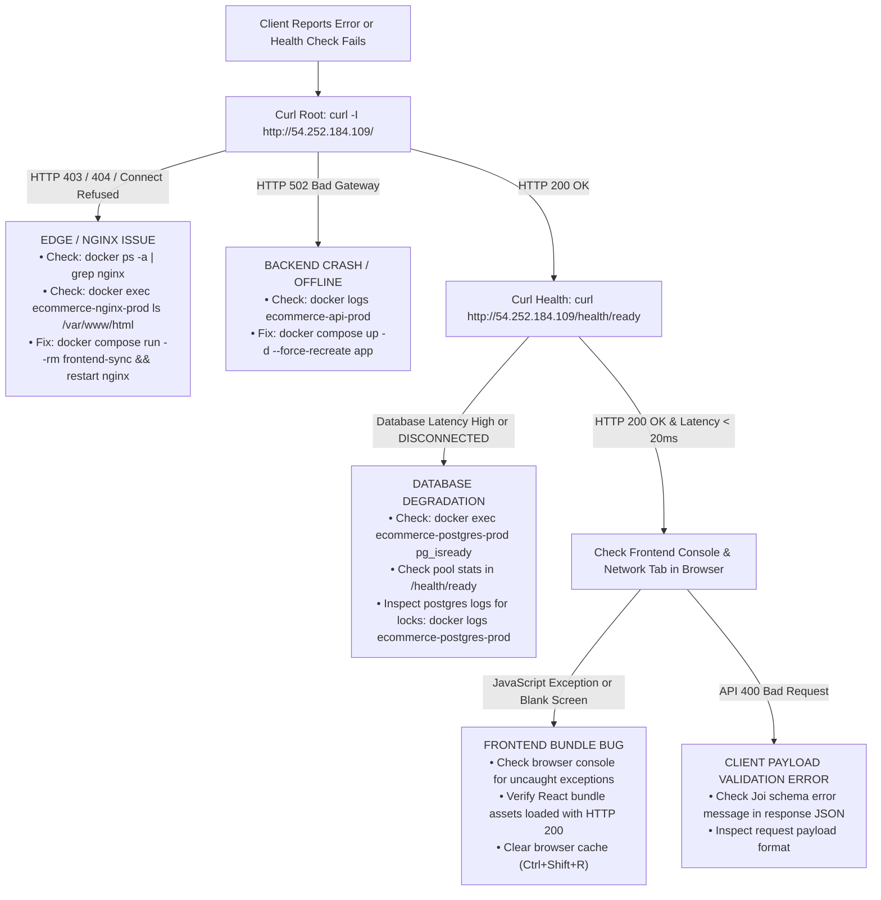

# Monitoring, Observability & Incident Diagnostics

**Company:** ALGIONS AI LABS PRIVATE LIMITED  
**Project:** Cloud Deployment & CI/CD – E-Commerce Platform  
**Target Host:** AWS EC2 Production (`54.252.184.109`)  
**Observability Components:** Node.js Prometheus Exporter (`prom-client`), Prometheus 2.51 (`ecommerce-prometheus-prod`), Structured Request Logger, Nginx Access Logger

---

## 1. Observability Architecture Overview

The platform implements multi-layer telemetry to monitor availability, system performance, error rates, and infrastructure bottlenecks:

```
┌─────────────────────────────────────────────────────────────┐
│ 1. Edge Layer: Nginx (ecommerce-nginx-prod)                 │
│    • Ingress Access Log: sanitized_combined                 │
│    • Request Latency Timing: rt, uct, uht, urt              │
└──────────────────────────────┬──────────────────────────────┘
                               │
                               ▼
┌─────────────────────────────────────────────────────────────┐
│ 2. Application Layer: Express API (ecommerce-api-prod)      │
│    • Liveness Probe: GET /health                            │
│    • Readiness Probe: GET /health/ready                     │
│    • Metrics Exporter: GET /metrics (prom-client)           │
│    • Structured Access Logging: JSON format                 │
└──────────────────────────────┬──────────────────────────────┘
                               │
                               ▼
┌─────────────────────────────────────────────────────────────┐
│ 3. Database Layer: PostgreSQL (ecommerce-postgres-prod)     │
│    • Native Probe: pg_isready -U postgres -d ecommerce_prod │
│    • Connection Pool Telemetry: total, idle, waiting sockets│
│    • Database Response Latency (ms)                         │
└─────────────────────────────────────────────────────────────┘
                               ▲
                               │ Scrapes /metrics (every 5s)
┌──────────────────────────────┴──────────────────────────────┐
│ 4. Metrics Storage: Prometheus (ecommerce-prometheus-prod)   │
│    • Port: 9090 (UI & Time-Series Database)                 │
│    • Target: app:3000/metrics                               │
└─────────────────────────────────────────────────────────────┘
```

---

## 2. Health & Readiness Probes

The application provides distinct liveness and readiness endpoints following cloud-native best practices:

### 2.1 Liveness Probe (`GET /health`)
- **Purpose:** Verifies that the Node.js event loop is unblocked and the HTTP server can accept connections.
- **Probe Command:**
  ```bash
  curl -s http://54.252.184.109/health | jq .
  ```
- **Response Format (HTTP 200 OK):**
  ```json
  {
    "success": true,
    "message": "Service is healthy",
    "data": {
      "status": "UP",
      "uptimeSeconds": 1845,
      "timestamp": "2026-11-15T16:42:42.956Z",
      "environment": "production",
      "version": "1.0.0"
    },
    "timestamp": "2026-11-15T16:42:42.956Z"
  }
  ```

### 2.2 Readiness Probe (`GET /health/ready`)
- **Purpose:** Verifies end-to-end operational readiness, including PostgreSQL connectivity, query execution latency, and V8 heap memory usage.
- **Probe Command:**
  ```bash
  curl -s http://54.252.184.109/health/ready | jq .
  ```
- **Response Format (HTTP 200 OK):**
  ```json
  {
    "success": true,
    "message": "All dependencies are healthy",
    "data": {
      "status": "UP",
      "uptimeSeconds": 1846,
      "timestamp": "2026-11-15T16:42:43.649Z",
      "environment": "production",
      "version": "1.0.0",
      "system": {
        "nodeVersion": "v20.20.2",
        "platform": "linux",
        "arch": "x64",
        "memoryUsageMB": {
          "rss": 59,
          "heapUsed": 12,
          "heapTotal": 14
        }
      },
      "dependencies": {
        "database": {
          "type": "PostgreSQL",
          "status": "CONNECTED",
          "latencyMs": 12,
          "serverTime": "2026-11-15T16:42:43.648Z",
          "pool": {
            "totalCount": 1,
            "idleCount": 1,
            "waitingCount": 0
          }
        }
      }
    },
    "timestamp": "2026-11-15T16:42:43.649Z"
  }
  ```

---

## 3. Prometheus Telemetry & Metrics Collection

### 3.1 Metrics Endpoint (`GET /metrics`)
The application integrates `prom-client` to export standard Prometheus metrics in text format (`text/plain; version=0.0.4`):
```bash
curl -s http://54.252.184.109/metrics | head -n 30
```

### 3.2 Metrics Captured:
1. **HTTP Request Telemetry:**
   - `http_requests_total{method="GET",route="/api/v1/products",status_code="200"}`: Counter tracking API throughput by method, route, and status code.
   - `http_request_duration_seconds_bucket{le="0.1",...}`: Histogram measuring request latency percentiles ($p50$, $p90$, $p99$).
2. **Process Metrics:**
   - `nodejs_heap_size_used_bytes`: Current V8 memory allocation.
   - `nodejs_eventloop_lag_seconds`: Event loop delay in seconds.
   - `process_cpu_user_seconds_total`: Cumulative user CPU utilization.
3. **Database Connection Pool Telemetry:**
   - `pg_pool_total_count`: Total active client connections in the pool.
   - `pg_pool_idle_count`: Idle pool sockets ready for queries.
   - `pg_pool_waiting_count`: Queries currently waiting for an available socket.

### 3.3 Prometheus Server Configuration (`prometheus/prometheus.yml`)
The Prometheus container runs with:
```yaml
global:
  scrape_interval: 5s
  evaluation_interval: 5s

scrape_configs:
  - job_name: 'ecommerce-api'
    metrics_path: '/metrics'
    static_configs:
      - targets: ['app:3000']
        labels:
          environment: 'production'
          service: 'ecommerce-cloud-devops-api'
```
The Prometheus dashboard is accessible in production at:
`http://54.252.184.109:9090`

> [!NOTE]
> In local development, port 3000 on the developer workstation is preserved for Grafana dashboards, while the local API is mapped to `localhost:3001`. On the production EC2 host, Prometheus collects metrics on port 9090.

---

## 4. Logging Standards

### 4.1 Application Structured Logging
All inbound HTTP requests are automatically logged as structured JSON objects:
```json
{
  "timestamp": "2026-11-15T16:42:44.309Z",
  "level": "INFO",
  "service": "ecommerce-api",
  "type": "http_access",
  "method": "GET",
  "route": "/api/v1/products",
  "url": "/api/v1/products",
  "statusCode": 200,
  "durationMs": 4.12,
  "ip": "54.252.184.109",
  "userAgent": "curl/8.21.0"
}
```
**Sensitive Header Redaction:** Authorization tokens and `x-admin-api-key` values are automatically scrubbed by `requestLogger.js` before being output to standard out.

### 4.2 Nginx Access & Error Logging
Nginx formats access logs using the custom `sanitized_combined` format in `/var/log/nginx/access.log`:
```
$remote_addr - $remote_user [$time_local] "$request_method $request_uri $server_protocol" $status $body_bytes_sent "$http_referer" "$http_user_agent" rt=$request_time uct="$upstream_connect_time" uht="$upstream_header_time" urt="$upstream_response_time"
```
Key latency timing variables:
- `rt`: Total request processing time.
- `uct`: Upstream connection time to Node.js container.
- `urt`: Upstream response time from Node.js container.

---

## 5. Failure Triage & Root Cause Isolation Matrix

When an alert fires or a user reports an anomaly, follow this decision tree to isolate whether the failure originates from the frontend, edge proxy, backend, or database:



### Detailed Diagnostic Cheatsheet:
1. **Frontend Only Issue (e.g. Blank Screen, CSS broken):**
   - Symptom: `/health` returns 200, but browser shows blank screen or console error.
   - Action: Inspect browser console. Verify that `index-*.js` and `index-*.css` return HTTP 200. Check volume synchronization (`docker exec ecommerce-nginx-prod ls -la /var/www/html/assets`).
2. **Reverse Proxy Only Issue (e.g. 502 Bad Gateway, SSL handshake error):**
   - Symptom: Public requests fail, but running `curl http://127.0.0.1:3000/health` inside the host returns 200.
   - Action: Inspect `/var/log/nginx/error.log` inside Nginx container. Verify upstream DNS resolution for `backend_app`.
3. **Backend Application Issue (e.g. High latency, 500 Internal Error):**
   - Symptom: Nginx returns 502/504; `/health` probe fails or timeouts.
   - Action: Run `docker logs --tail 100 ecommerce-api-prod`. Look for unhandled promise rejections, memory exhaustion, or database connection timeouts.
4. **Database Issue (e.g. Connection pool exhaustion, lock wait timeout):**
   - Symptom: `/health` returns 200, but `/health/ready` returns 503 or latency > 1000ms.
   - Action: Run `docker exec ecommerce-postgres-prod psql -U postgres -d ecommerce_prod -c "SELECT pid, query, state, age(clock_timestamp(), query_start) FROM pg_stat_activity WHERE state != 'idle';"`.
